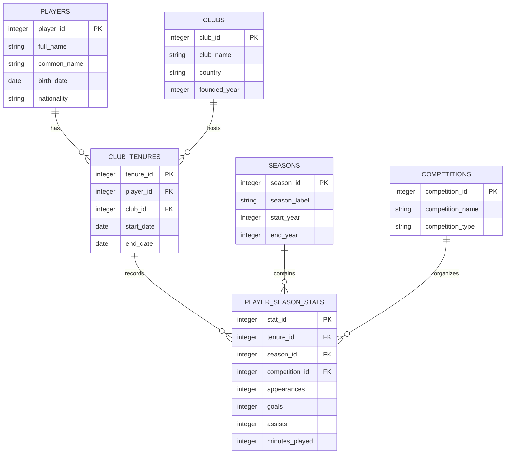

# FGI Entity-Relationship Diagram

**Version:** 0.1 
**Status:** Preliminary Design 
**Milestone:** 1 — Database Architecture

## Initial Database Relationships

## Relationship Notes

- A player may have multiple club tenures.
- A club may have multiple player tenures.
- Each club tenure belongs to one player and one club.
- Each statistical record refers to one club tenure, one season, and one competition.
- A season or competition can be associated with multiple statistical records.

## Design Considerations

This preliminary model focuses on club football. National-team participation and more detailed competition editions will be added later.

Dates, keys, constraints, and statistical record uniqueness require further review before SQL implementation.